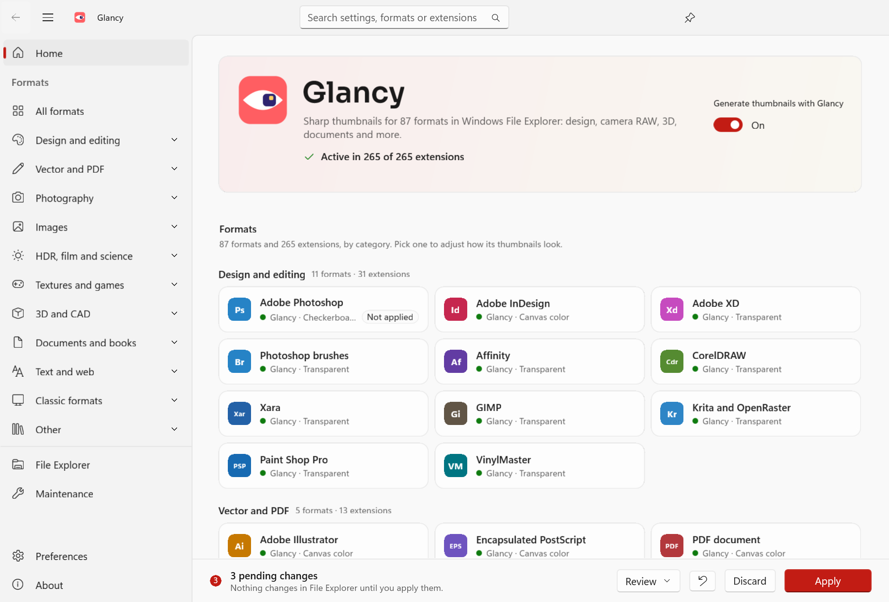

# Glancy

Thumbnails in Windows File Explorer for **87 formats (265 extensions)** that Windows does not preview on its own, or
previews without control: design files (PSD, AI, EPS, PDF, SVG, InDesign, CorelDRAW, Affinity…), photography and
camera RAW, HDR, game textures, 3D and CAD, documents, e-books, text and more. Glancy covers the formats MysticThumbs
supports, with a settings app redesigned for Windows 11.



Glancy has two parts:

* **The thumbnail engine**, `Glancy.Thumbnails.dll`: a COM `IThumbnailProvider` written in Rust that File Explorer
  loads. Per format you choose whether Glancy draws the thumbnail or leaves it to the system provider, and how it looks:
  transparency or checkerboard, canvas color, square canvas, scaling, gamma, embedded previews, size limits, overlay
  icon and shadow.
* **The settings app**, `Glancy.exe` (WinUI 3): every setting with a live preview, pending changes applied in one step,
  the engine's status and history, cache maintenance, import and export. In English, Spanish, German, French,
  Portuguese (Brazil), Japanese and Chinese (Simplified).

The two share one format catalog (`src/Glancy.Core/Settings/formats.json`) and talk only through the registry
([docs/registry-contract.md](docs/registry-contract.md)).

Glancy is free, open source and has no ads. If it's useful to you, you can support it through
[GitHub Sponsors](https://github.com/sponsors/sergiocespedesp), [Ko-fi](https://ko-fi.com/sergiocespedesp) or
[Buy Me a Coffee](https://buymeacoffee.com/sergiocespedesp).

## Installing

Run `GlancySetup-<version>.exe`. It installs the app and the engine for the current user, without administrator
rights, in `%LOCALAPPDATA%\Programs\Glancy`, on Windows 10 2004 or later (x64). It registers the engine, saving the
thumbnail providers it replaces, and adds Glancy to Start (and, optionally, the desktop). Running a newer setup
upgrades in place, even while File Explorer has the engine loaded, and keeps your settings. Home shows whether the
engine is registered and active for each format.

The setup is not code-signed yet, so Windows SmartScreen may warn before running it.

Uninstall from Settings › Apps: it restores the previous thumbnail providers, removes the Jump List and the
notification identity, and asks whether to delete your settings and history too (silent uninstalls keep them). Engine
files that File Explorer still holds are moved to the temp folder and deleted at the next sign-in.

Silent install and uninstall: `GlancySetup-<version>.exe /VERYSILENT /SUPPRESSMSGBOXES /NORESTART` and
`%LOCALAPPDATA%\Programs\Glancy\unins000.exe /VERYSILENT /SUPPRESSMSGBOXES /NORESTART`.

PostScript files without an embedded preview (EPS, AI before CS) need [Ghostscript](https://ghostscript.com) 10.03.1
or later installed separately; Glancy does not bundle it.

## Building

Requirements: Windows 11 x64, the .NET 10 SDK and Rust with the `x86_64-pc-windows-gnu` toolchain
(`rustup-init --default-host x86_64-pc-windows-gnu`). Visual Studio is not needed. Build output goes to
`%LOCALAPPDATA%\Temp\lmb` (see `Directory.Build.props`) to stay under the 260-character path limit.

Engine (runs the tests, downloads a pinned PDFium and checks its SHA-256, and leaves everything in `dist/Engine`):

```bash
powershell -NoProfile -ExecutionPolicy Bypass -File tools/build-engine.ps1
```

App:

```bash
dotnet build src/Glancy.Settings/Glancy.Settings.csproj -c Release -p:Platform=x64
```

```bash
dotnet publish src/Glancy.Settings/Glancy.Settings.csproj -c Release -p:Platform=x64 -r win-x64 --self-contained false -p:PublishReadyToRun=true -o dist/Glancy
```

`--self-contained false` needs the .NET 10 runtime on the target machine; `--self-contained true` (about 215 MB) needs
nothing installed.

Setup (needs [Inno Setup 6](https://jrsoftware.org/isinfo.php): `winget install --id JRSoftware.InnoSetup --scope user`).
It builds the engine with its tests (`-SkipEngine` reuses `dist/Engine`), publishes the app self-contained and compiles
`installer/Glancy.iss` into `dist/Installer/GlancySetup-<version>.exe` (about 60 MB); the version comes from
`Directory.Build.props`:

```bash
powershell -NoProfile -ExecutionPolicy Bypass -File tools/build-installer.ps1
```

During development the engine alone can be installed with `tools/install-engine.ps1` (`-Uninstall` to remove it); it
uses the same folder and registration as the setup.

## Testing

```bash
dotnet test --project tests/Glancy.Core.Tests/Glancy.Core.Tests.csproj
```

End-to-end test of the real app through UI Automation (runs the UI in English with `--lang en`; uses Glancy's real
registry key and leaves it at the defaults):

```bash
powershell -NoProfile -ExecutionPolicy Bypass -File tools/e2e.ps1 -Exe dist/Glancy/Glancy.exe
```

End-to-end test of the setup on the real system: silent install, upgrade while a process holds the engine DLL, silent
uninstall with the DLL still loaded, and a final install that leaves Glancy installed (run it from a normal shell):

```bash
powershell -NoProfile -ExecutionPolicy Bypass -File tools/installer-e2e.ps1 -Setup dist/Installer/GlancySetup-1.0.0.exe
```

End-to-end test of the installed engine (changes real settings and restores them exactly):

```bash
powershell -NoProfile -ExecutionPolicy Bypass -File tools/engine-e2e.ps1
```

To diagnose one file: `glancy-thumb.exe shell <file> [size] [out.png]` asks the Windows thumbnail cache, as Explorer
does; `render`, `com` and `clsid` isolate the engine or compare it with another provider.

## Command line

`Glancy.exe` options:

* `--page <home|all|<format>|<format>|<.ext>|explorer|maintenance|preferences|about>` opens a page, for example
  `--page raw` or `--page psd|.psb` (format ids are in `formats.json`; if Glancy is already open, that window navigates).
* `--capture <file.png>` / `--capture-set <folder>` render the UI to PNG (visual QA, also in a locked session);
  `--theme light|dark`, `--width`, `--height`, `--demo` (creates 3 sample pending changes; never applied).
* `--lang <en|es|de|fr|pt-BR|ja|zh-Hans>` sets the UI language for that run only. Without it Glancy uses the Language
  preference or the Windows language ([docs/localization.md](docs/localization.md)).
* `--action <enable|disable|refresh-explorer|clear-cache>` runs an action without opening the window and reports it
  with a Windows notification. `enable`/`disable` apply only the master switch at once (other pending changes stay
  pending). If the window is open, that process runs the action. Exit code: 0 success, 1 failure, 2 unknown action.
* `--cleanup`, used by the uninstaller: deletes the Jump List and the notification identity, without a window. Exit
  code 0, or 1 if a step failed.

### Jump List

With Glancy pinned to the taskbar (or from Start), right-clicking it shows "Turn off Glancy thumbnails" or "Turn on
Glancy thumbnails" (following the current state), "Refresh File Explorer", "Clear thumbnail cache" and shortcuts to
All formats, File Explorer options and Maintenance. The app rewrites the list when it starts and when the master switch changes
(`Glancy.Core.Shell.JumpList`, `Services/QuickActions.cs`); nothing stays running. Notifications use the
`Glancy` identifier, registered in `HKCU\Software\Classes\AppUserModelId\Glancy`.

## Repository layout

| Path | Contents |
|---|---|
| `src/Glancy.Thumbnails` | The engine in Rust: `Glancy.Thumbnails.dll` and the diagnostic tool `glancy-thumb.exe`. |
| `src/Glancy.Core` | Format catalog (`Settings/formats.json`), settings, pending changes, registry store, import/export, shell services. No UI. |
| `src/Glancy.Settings` | The WinUI 3 app (Windows App SDK, .NET 10, unpackaged). |
| `tests/Glancy.Core.Tests` | xUnit v3 tests of the core (they use their own test registry key and delete it). |
| `installer/` | `Glancy.iss` (Inno Setup script), the zh-Hans wizard translation and the wizard images. |
| `.github/` | `workflows/build.yml` (tests, engine and setup on every push; a `vX.Y.Z` tag publishes a release) and `FUNDING.yml`. |
| `tools/` | `build-engine.ps1`, `build-installer.ps1`, `install-engine.ps1`, `engine-e2e.ps1`, `installer-e2e.ps1`, `e2e.ps1`, `shot.ps1`; `make_icon.py` generates the icon, PNGs, `docs/brand/` and `installer/images/` (Pillow + fonttools; tests in `test_make_icon.py`). |
| `docs/architecture.md` | Components, formats and decoders, registration, safety, testing, known limitations. |
| `docs/registry-contract.md` | The settings contract between the app and the engine, and `history.log`. |
| `docs/design-system.md` | Tokens, components and patterns of the app. |
| `docs/brand-identity.md`, `docs/brand/` | Symbol, palette, logo and the files. |
| `docs/localization.md` | Where strings live, how the language is chosen, glossary. |
| `docs/screenshots/` | Screenshots of the app. |

## Third-party components

* Engine: [PDFium](https://pdfium.googlesource.com/pdfium/) (BSD-3-Clause, shipped as `pdfium.dll` with its bundled
  libraries' licenses), [resvg](https://github.com/linebender/resvg), [image](https://github.com/image-rs/image),
  [jxl-oxide](https://github.com/tirr-c/jxl-oxide), [hayro-jpeg2000](https://github.com/LaurenzV/hayro),
  [texture2ddecoder](https://github.com/UniversalGameExtraction/texture2ddecoder), `cfb`, `fax`, `flate2`, `quick-xml`,
  `ruzstd`, `serde`, `zip` and [windows-rs](https://github.com/microsoft/windows-rs) (MIT and/or Apache 2.0).
* App: [Windows App SDK](https://github.com/microsoft/WindowsAppSDK) and .NET (MIT); the
  [Sora](https://github.com/sora-xor/sora-font) typeface for the logo (SIL Open Font License).
* Optional, not bundled: [Ghostscript](https://ghostscript.com) (AGPL) for PostScript without a preview.

The About page in the app lists every component with its copyright and license.

## License

Copyright © 2026 Sergio Cespedes.

Glancy is free software: you can redistribute it and/or modify it under the terms of the GNU General Public License as
published by the Free Software Foundation, either version 3 of the License, or (at your option) any later version. It
is distributed in the hope that it will be useful, but WITHOUT ANY WARRANTY; see [LICENSE](LICENSE) for details.
